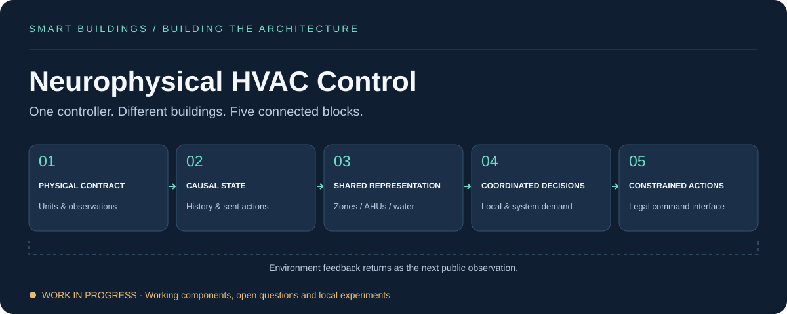

# Neurophysical HVAC Control

**Building a controller that can learn the building, not memorize it.**

I’m developing a neural architecture for heating, ventilation and air conditioning in the [Smart Buildings Competition — NeurIPS 2026](https://smart-buildings-2026.github.io/competition/). The question behind this project is simple: **can the same controller make good decisions in a building it has never seen before?**

Buildings have different layouts, equipment and thermal behavior. A useful controller has to work with those differences while keeping people comfortable and accounting for energy cost and carbon emissions.

## Building the architecture, block by block

### 01 · Understand what the building is telling us

Start with the physical meaning of each input: temperatures, comfort bands, equipment signals and the relationships between zones and air-handling units. A temperature setpoint is a request; it is not necessarily the temperature the equipment delivers. Getting that distinction right comes before learning.

### 02 · Give the controller a sense of time

Buildings respond slowly. A single reading cannot describe everything happening inside them. The current controller uses simple causal history, including temperature changes and previous commands. Richer learned memory is a direction I want to test, rather than assume it will help.

### 03 · Learn representations that can be reused

Instead of designing a separate network for each floor plan, share neural encoders across zones and equipment. Combine local information into air-handler and water-system context. This lets the architecture accommodate different numbers of zones; making those representations transfer well is the harder research question.

### 04 · Bring local and shared decisions together

One air handler serves several zones, and their needs can conflict. Cooling, airflow and reheat also affect one another. The architecture connects local zone decisions with shared equipment outputs. I’m investigating which forms of coordination improve control enough to justify their complexity.

### 05 · Turn predictions into usable commands

Translate the network’s outputs into the building’s permitted action interface, apply operational constraints and remember the command actually sent. Valid commands are a starting point; comfort still has to be checked in closed-loop evaluation.

[Explore the architecture →](docs/architecture.md)

## What I’ve built so far

A shared neural baseline, physical feature processing, simple temporal state and constrained action outputs are implemented and have been evaluated locally. These pieces provide a working foundation for the broader five-block design.

The experiments have also shaped what I haven’t kept. Adding more context and communication did not produce enough benefit in the local comparison. Improvements seen in one development case have not consistently carried over to others. That makes transfer a problem to investigate, not a result to claim.

The complete architecture is still being developed. Recurrent memory and thermal relationships between neighboring zones remain research ideas. A reinforcement-learning mechanism has passed technical preflight checks, but has not established an improvement through real training rollouts.

[Progress and lessons →](docs/research-status.md)

## How I decide what belongs in the model

I want each block to earn its place. That means comparing it with a simpler alternative, measuring the controller over complete trajectories and looking at uncomfortable periods as carefully as average performance. Better imitation of another controller does not automatically mean better control.

The policy uses only information available at decision time. Experimental comparisons keep track of provenance and separate development findings from evidence of generalization. [Read the evaluation approach →](docs/evaluation.md)

## Where this is going

The goal is a compact, physically meaningful controller that can adapt to unfamiliar building structures. The next questions are whether better temporal state helps, whether coordination avoids conflicting actions, and whether thermal relationships add useful information beyond equipment connections.

This repository shares the architecture and the thinking behind its construction. Competitive controller code, trained weights and experiment data remain private. It is an independent project; the simulator and reference interface come from the [official starter kit](https://github.com/smart-buildings-2026/starter-kit). [Sources and attribution →](docs/sources.md)
