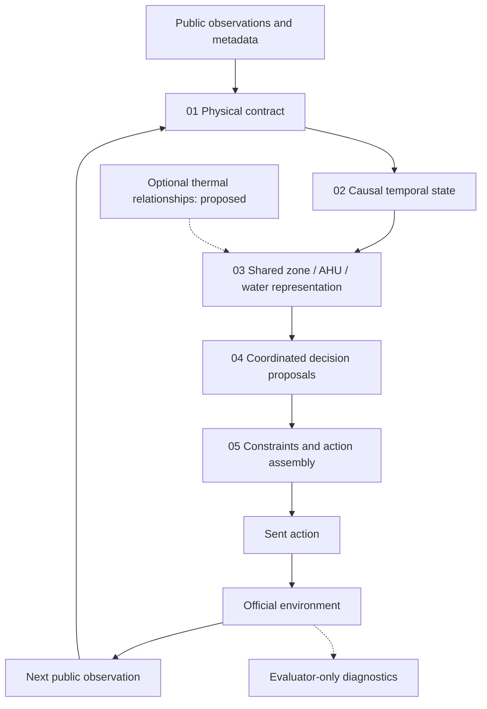

# Five-layer architecture

[Overview](../README.md) · [Progress and lessons](research-status.md)

**How the blocks fit together.** “Neurophysical” means that physical semantics and system structure inform a learned controller. It does not imply exact identification of thermal parameters or a formal safety guarantee.

## 01 · Physical contract

Interpret public observations and metadata before constructing learned features. Distinguish measured zone temperatures, active references, equipment commands and inferred quantities. Use the official mapping between zones and air-handling units (AHUs), rather than assuming a fixed ordering or fixed number of actuators.

The inspected simulator separates air-side cooling from zone reheat supplied by the hot-water system. These asymmetric roles motivate separate treatment of cooling demand, heating demand and transport capacity. A command can be within its legal range and still have limited physical authority.

Some AHU channels named as supply-air temperature or pressure can reflect setpoints rather than independently measured delivery. Such channels must not be described as measurements of delivered cooling or fan power. This distinction constrains what can be inferred from logs.

**Evidence:** feature construction and metadata mapping exist in the local neural baseline. A comprehensive physical state estimator is not established.

## 02 · Causal state

The implemented baseline includes temperature differences, bounded integral features and previous commands. State is updated from information available when the decision is made, then the action actually sent is retained for the next step. Episode reset prevents history from one building episode contaminating another.

These features summarize history; they do not measure wall temperature or identify hidden loads. Multiscale filters, small shared recurrent networks and adaptive thermal predictors are candidate extensions. Any learned state must earn its complexity through comparison with simpler causal summaries.

**Evidence:** simple causal history is implemented and used in local evaluations. Recurrent memory remains proposed in this reviewed scope.

## 03 · Shared neural representation

Use shared encoders across zones and across AHUs. Aggregate zone information into the corresponding AHU context, and equipment information into water-system context. The number of entities may change while representation widths and learned parameter roles remain shared.

The implemented baseline combines group summaries with local features. Aggregation is intended to preserve both collective demand and extreme conditions; whether it captures the information needed for transfer is an experimental question.

Two relationships must remain distinct: **HVAC incidence** describes which equipment serves a zone; **thermal adjacency** describes possible heat exchange between spaces. Geometric proximity does not establish thermal coupling strength. A thermal graph would add a separate, explicitly tested information channel.

**Evidence:** shared encoders and HVAC aggregation are implemented. A thermal graph or mixture of experts is not established as an operational component of this design.

## 04 · Coordinated decisions

Produce local zone actions and shared equipment decisions within one hierarchical policy. Shared air supply means that a zone's preferred action can conflict with another zone's needs; local reheat also interacts with cooling and water-system operation.

The implemented baseline has zone, AHU and water-system outputs. Context and same-step action-message variants were evaluated locally without earning promotion. Their result motivates careful ablation rather than a claim of solved energy coordination.

**Evidence:** hierarchical outputs exist. Additional explicit coordination remains a research hypothesis; the full coordinated design is not validated.

## 05 · Constrained actions

Map neural outputs into the permitted command interface, using the metadata-defined actuator mapping. Retain the final sent action after constraints, rather than an unconstrained proposal. Monitor the distinction between the sent command and the environment's resulting behavior.

Action-range compliance is a software/interface property. Comfort and physical safety are outcomes that require separate evidence; clipping or operational gates do not prove them.

**Evidence:** action assembly, range constraints and command history are implemented. No formal comfort or real-building safety guarantee is claimed.

## Information flow

The diagram depicts the research design, not deployment status. Evaluator-only diagnostics have no return edge to the inference policy. Training objectives and offline analysis are distinct from information available to the acting policy.
